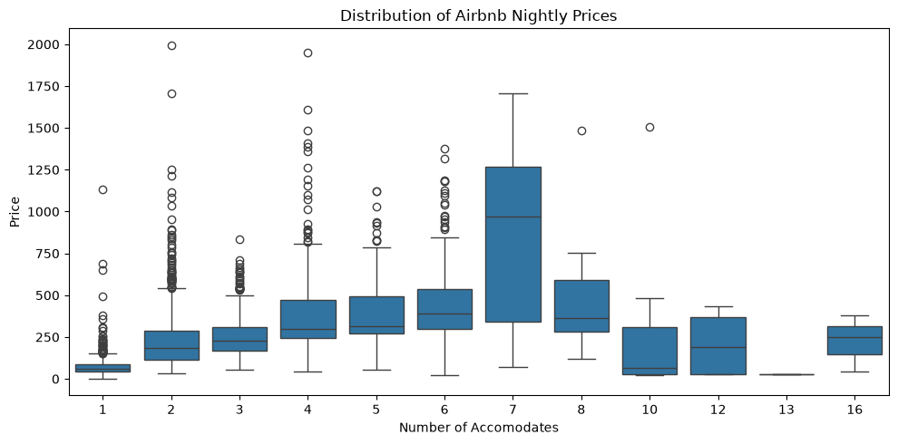
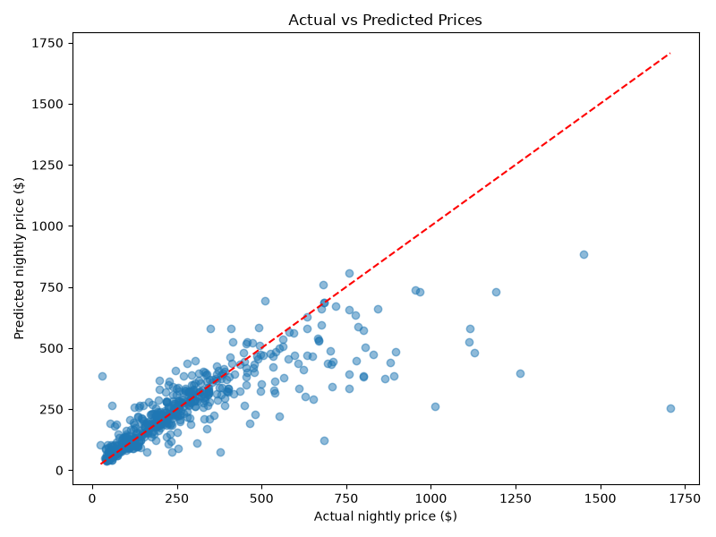
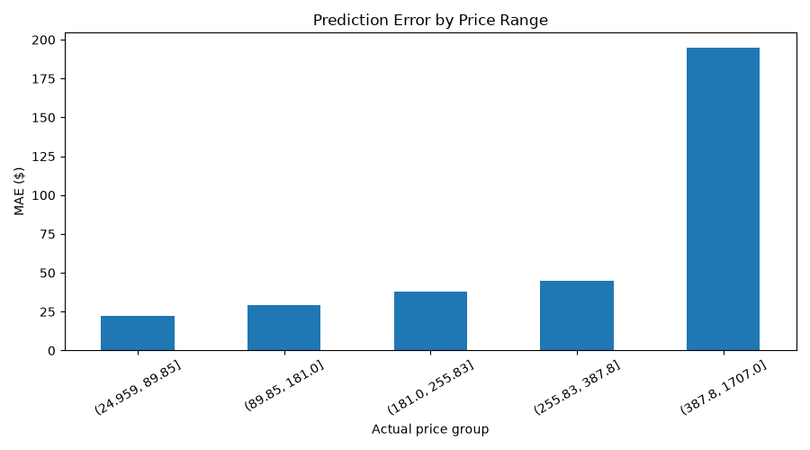

# Singapore Airbnb Price Prediction

Predicting nightly Airbnb accommodation prices in Singapore using machine learning.

---

## Overview
This project explores several regression approaches to estimate nightly accommodation prices using listing characteristics, location, host information, reviews and amenities.

The goal is to investigate how different modelling approaches perform on real-world accommodation data, understand the factors influencing price predictions, and identify the limitations of the resulting models.

## Dataset

- **Source:** InsideAirBnb https://insideairbnb.com/get-the-data/ 
- **Geographical scope:** Singapore
- **Initial dataset size:** 2,728 listings
- **Target variable:** Nightly listing price
- **Task:** Supervised regression

The dataset contains information about individual Airbnb listings, including:

- Property characteristics such as bedrooms, bathrooms and accommodation capacity.
- Geographical information such as latitude, longitude and neighbourhood.
- Host characteristics and listing activity.
- Guest reviews and ratings.
- Listing amenities.

## Exploratory Data Analysis

Exploratory data analysis was conducted to understand the dataset, investigate price distributions and identify potentially useful predictive features.

See the [EDA notebook](notebooks/01_eda.ipynb) for the full analysis.




### Key observations

- Listing prices exhibit a right-skewed distribution, with a relatively small number of expensive properties.
- Listings vary considerably in price across property characteristics and locations.
- Amenities provide information about listing characteristics.

## Methodology

### Data preprocessing and feature engineering

The following preprocessing steps were implemented:

- Handling missing numerical and categorical values.
- Extracting numerical bathroom counts and bathroom types from text.
- Extracting individual amenity indicators and amenity counts.
- Selecting frequently occurring amenities.
- Encoding categorical variables using one-hot encoding.
- Scaling numerical features where appropriate.

Scikit-learn pipelines and `ColumnTransformer` were used to organise preprocessing and model training. Feature selection for amenities was performed within the modelling pipeline to avoid data leakage during cross-validation.

### Model development

Several regression algorithms were investigated:

| Model | Motivation |
|---|---|
| Linear Regression | Linear baseline |
| Ridge Regression | Regularised linear model |
| Random Forest | Nonlinear ensemble learning |
| Extra Trees | Randomised tree ensemble |
| HistGradientBoosting | Gradient boosting |
| XGBoost | Gradient-boosted trees |
| Support Vector Regression | Nonlinear regression |

Both original-price and log-transformed target approaches were explored to investigate the effect of the highly skewed price distribution.

### Hyperparameter tuning

GridSearchCV with 5-fold cross-validation was used to tune selected models.

The search explored parameters including:
- Number of estimators.
- Maximum tree depth.
- Minimum samples per leaf.
- Maximum features considered at each split.

## Model Evaluation

Models were evaluated using three regression metrics:

- **MAE:** Mean absolute prediction error.
- **RMSE:** Penalises larger prediction errors more heavily.
- **R²:** Measures the proportion of variance in the target explained by the model.

### Model comparison

Two models emerged as interesting, each performing best on different evaluation metrics.

| Model | MAE | RMSE | R² |
|---|---:|---:|---:|
| Random Forest (100 Trees) | 72.08 | 131.07 | 0.668 |
| Linear Regression | 103.38 | 169.24 | 0.446 |
| Extra Trees Regressor | 71.26 | 138.34 | 0.630 |
| Hist Gradient Boosting | 75.12 | 136.54 | 0.639 |
| Log Price Random Forest (100 Trees) | 66.52 | 138.32 | 0.630 |
| Log Price Random Forest (300 Trees) | 66.10 | 137.48 | 0.634 |
| Log Price XGBoost | 70.29 | 142.88 | 0.605 |
| Random Forest (300 Trees) | 71.46 | **129.24** | **0.677** |
| Ridge Regression | 102.90 | 168.78 | 0.449 |
| SVR | 100.31 | 188.86 | 0.310 |
| XGBoost | 76.02 | 140.22 | 0.619 |
| Log Price Extra Trees | 67.82 | 139.47 | 0.624 |
| Tuned Log Random Forest | **65.72** | 137.99 | 0.631 |
| Tuned Random Forest | 72.26 | 139.71 | 0.622 |

The tuned log-transformed Random Forest achieved the lowest MAE, indicating better average absolute prediction accuracy.

However, the original-price Random Forest achieved lower RMSE and higher R², suggesting stronger overall performance when accounting for larger errors and variance explained.

These results highlight a trade-off between the two approaches rather than a single model dominating every metric.

## Error Analysis

Error analysis was conducted on the tuned log-transformed Random Forest to investigate prediction behaviour across different price ranges.





### Key findings

- Prediction errors generally increase with actual listing price.
- The model performs more consistently across lower and middle price ranges.
- Expensive listings are systematically underpredicted.
- The highest-priced listings contribute disproportionately to the overall prediction error.

Further inspection of the listings revealed that some of the largest errors came from legitimate luxury properties, including penthouses with nightly prices exceeding $1,400.

This suggests that the available features may not fully capture the characteristics that distinguish luxury accommodation from more typical listings.

## Conclusion

This project explored several machine learning approaches to predicting Airbnb nightly prices in Singapore.

The experiments demonstrated the importance of preprocessing, feature engineering, cross-validation, hyperparameter tuning and target transformation when working with skewed real-world data.

The two strongest Random Forest approaches demonstrated different strengths: the log-transformed model achieved lower MAE, while the original-price model performed better in terms of RMSE and R².

Despite predictive performance, accurately estimating luxury listings remains a challenge.

### Limitations and Future Improvements

- **Dataset size:** The relatively small number of listings limits the amount of information available to learn complex pricing patterns.
- **Luxury properties:** Additional features describing property quality and luxury characteristics may improve predictions for expensive listings, such as through TF-IDF on name/ description
- **Temporal information:** Incorporating seasonality and market trends could help account for price fluctuations.
- **Feature Creation:** Can try implementing features like distance to CBD or nearest MRT


## Project Structure

```text
singapore-airbnb-price-prediction/
├── data/
│   ├── raw/
│   └── processed/
├── notebooks/
│   └── 01_eda.ipynb
├── src/
│   ├── features.py
│   ├── preprocessing.py
│   ├── train.py
│   ├── error_analysis.py
│   └── evaluate.py
├── models/
├── reports/
│   ├── eda/
│   ├── error_analysis/
│   └── figures/
├── README.md
└── requirements.txt
```

## Technologies

- Python
- Pandas and NumPy
- Matplotlib and Seaborn
- Scikit-learn
- XGBoost
- Joblib